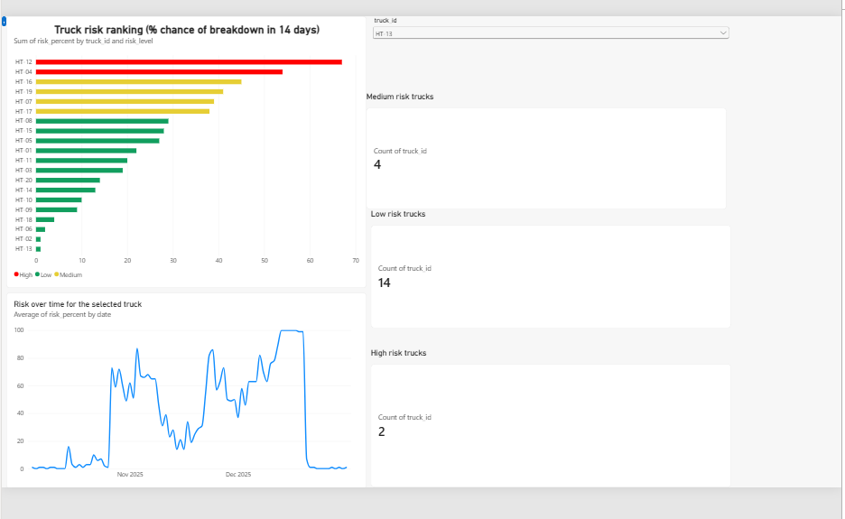

# Predictive Maintenance for Haul Trucks

A small end-to-end project that predicts which mining haul trucks are at risk of an unplanned breakdown in the next 14 days, and shows the result in a Power BI dashboard fed from AWS S3.

> **All data in this project is simulated.** The goal is to demonstrate the pipeline and the evaluation thinking, not to claim the model works on a real fleet.



## The problem

Most reporting tells you what already happened: "this truck had downtime last month". Predictive maintenance asks a different question: **which trucks are likely to fail soon, so they can be inspected on a planned stop instead of breaking down in the pit?**

## What I built

```
Python (simulate)  ->  Python (features)  ->  scikit-learn (model)  ->  AWS S3  ->  Power BI
truck_data.csv         truck_features.csv     truck_risk_scores.csv     private      risk dashboard
                                                                        bucket
```

| Step | Script | What it does |
|---|---|---|
| 1 | `src/simulate_trucks.py` | Creates a year of daily records for 20 trucks (vibration, hours since service, age, breakdowns). Vibration climbs in the two weeks before 80% of breakdowns. The other 20% are sudden, with no warning. |
| 2 | `src/build_features.py` | Turns raw readings into recent-history features: 7-day average vibration, week-over-week vibration trend, breakdowns in the last 30 days. |
| 3 | `src/train_model.py` | Trains a random forest on the earlier days, tests it on later days it has never seen, and writes a risk score (0 to 1) for every truck-day. |
| 4 | `src/prepare_dashboard_data.py` | Adds a High / Medium / Low risk level and builds the two tables the dashboard uses. |
| 5 | `src/test_s3_read.py` | Checks that Python can read the dashboard files from the S3 bucket using a read-only login. |

## Method

- **Target:** will this truck have an unplanned failure within the next 14 days? (binary classification)
- **Features:** truck age, hours since last service, vibration, 7-day average vibration, week-over-week vibration trend, breakdowns in the last 30 days.
- **Model:** random forest, 200 trees, `class_weight="balanced"` because failures are rare.
- **Validation:** split by date. Training uses 14 Jan to 4 Oct 2025 (5,280 truck-days). The test set is 5 Oct to 31 Dec 2025 (1,760 truck-days). Splitting by date matches real use, where you predict the future from the past, and avoids the model seeing the future during training.

## Results

In the test period, 308 truck-days were really followed by a breakdown within 14 days. Accuracy is misleading here because failures are rare, so I evaluated with recall and precision at several thresholds:

| Threshold | Trucks flagged | Caught | Missed | False alarms | Recall | Precision |
|---|---|---|---|---|---|---|
| 0.3 | 574 | 243 | 65 | 331 | 79% | 42% |
| 0.4 | 447 | 225 | 83 | 222 | 73% | 50% |
| 0.5 | 344 | 200 | 108 | 144 | 65% | 58% |
| 0.6 | 254 | 173 | 135 | 81 | 56% | 68% |
| 0.7 | 184 | 149 | 159 | 35 | 48% | 81% |

- **Recall** answers "of the real breakdowns, how many did we catch?"
- **Precision** answers "of the trucks we flagged, how many were really about to fail?"

**The threshold is a business decision, not a modelling one.** A missed breakdown (lost production, blocked haul road, possible damage) costs far more than an unnecessary inspection, so a mine would lean toward a lower threshold such as 0.3 to 0.4 and accept more false alarms. The right value depends on how many inspections the maintenance team can handle. Pushed too low, alerts stop meaning anything and crews start ignoring them.

**Most useful features:** `downtimes_30d` (30%), `vibration` (22%), `vibration_7d_avg` (16%), `vibration_trend` (16%), `hours_since_service` (11%), `truck_age_years` (5%). The three vibration features together account for about 54%, matching the pattern built into the simulation.

## The dashboard

Built in Power BI Desktop, loading both tables straight from S3 with a Python script:

- **Ranking chart:** all 20 trucks by current risk, coloured High (50% or more), Medium (30 to 50%) or Low.
- **Summary cards:** how many trucks are High, Medium and Low on the latest day.
- **Risk over time:** pick a truck and see its risk score across the test period. For example, HT-13's risk climbs to close to 100% in mid-December, about a week before its simulated breakdown on 20 December, then drops after the repair.

## How the data gets from AWS into Power BI

Power BI has no built-in S3 connector, so the dashboard uses a Python script as its data source:

```python
import io
import boto3
import pandas as pd

session = boto3.Session(profile_name="powerbi-reader", region_name="ap-southeast-2")
s3 = session.client("s3")

def read_csv(key):
    obj = s3.get_object(Bucket="<your-bucket-name>", Key=key)
    return pd.read_csv(io.BytesIO(obj["Body"].read()), parse_dates=["date"])

latest = read_csv("dashboard_latest.csv")
daily = read_csv("dashboard_daily.csv")
```

Security choices:
- The S3 bucket is private (Block all public access is on).
- Power BI uses a separate IAM user with a policy that only allows `s3:GetObject` and `s3:ListBucket` on this one bucket.
- The access keys live in `~/.aws/credentials` on my machine, outside the repository. No keys are in the code.

## Limitations

- **The data is simulated.** The model finds the pattern I planted, which shows the pipeline works. It doesn't show the same performance on a real fleet.
- **`downtimes_30d` ranks first partly because of a quirk of the simulation:** right after a breakdown the truck is repaired and rarely fails again soon. Real fleets may behave differently.
- **Rows are not independent.** One breakdown produces up to 14 positive truck-days (the 14 days before it), so the 308 positives are not 308 separate failures.
- **The last 14 days of the year can't see breakdowns after 31 December**, so their labels slightly understate the true risk.
- **One date split, no tuning.** I did not tune the model or use cross-validation. The threshold table is illustrative, and the cost trade-off is argued in words with no real cost figures.

## Ideas for next steps

- Plain-English explanations of why each truck was flagged, using a language model on top of the risk scores.
- A cost-based threshold: choose the cut-off that minimises (missed breakdown cost x misses) + (inspection cost x false alarms).
- Time-series cross-validation and a comparison with a logistic regression baseline.
- Run the pipeline end to end from Python, including uploading the files to S3.

## Run it yourself

```
python -m venv venv
venv\Scripts\activate          # Windows
pip install -r requirements.txt

python src/simulate_trucks.py
python src/build_features.py
python src/train_model.py
python src/prepare_dashboard_data.py
```

Run each command from the project's main folder. Uploading to S3 and the Power BI report need your own AWS account and Power BI Desktop.

## Tech

Python, pandas, NumPy, scikit-learn, boto3, AWS S3 and IAM, Power BI.
